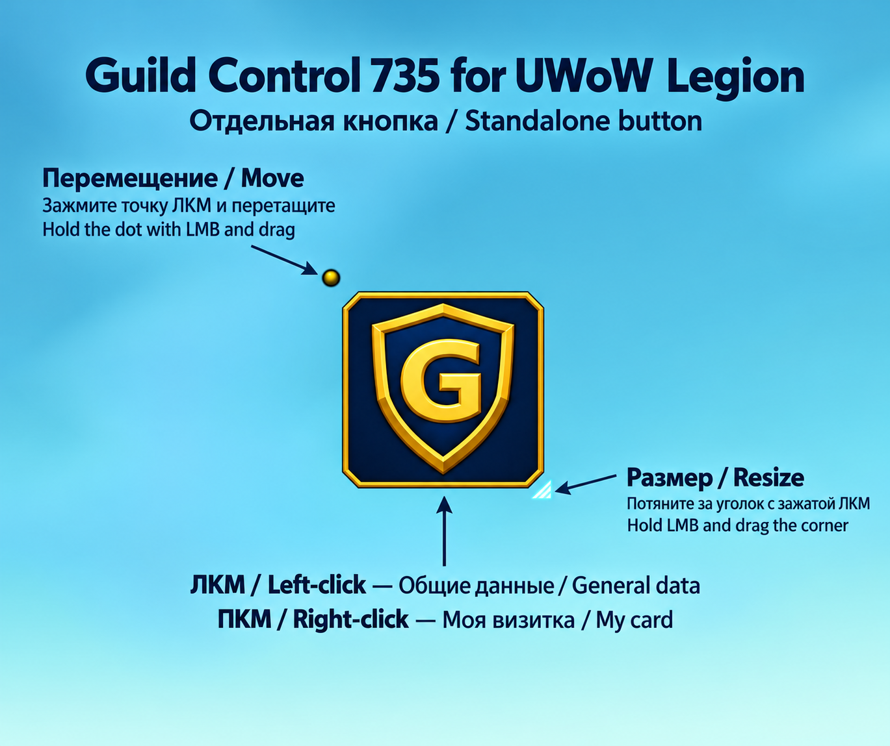
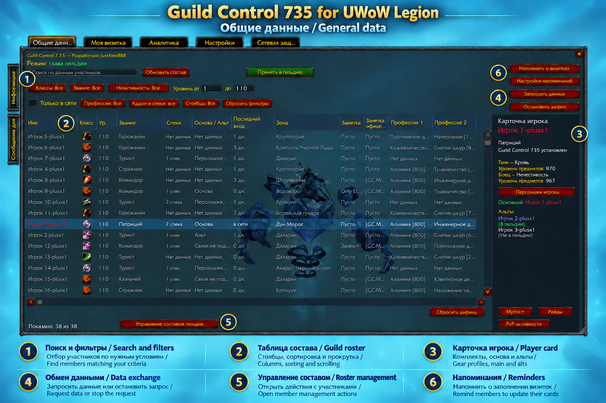
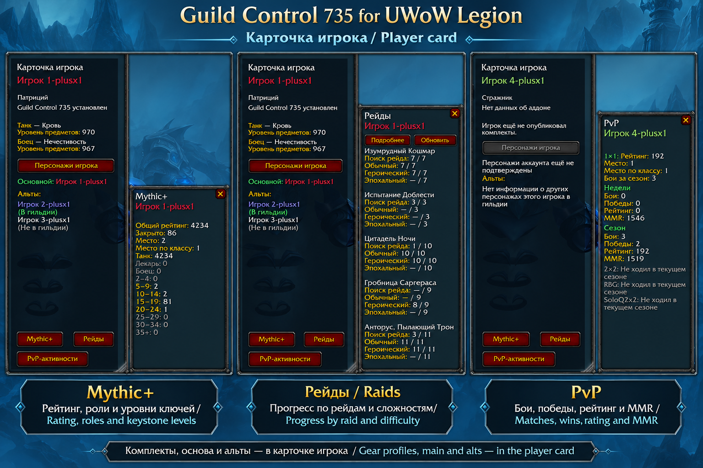
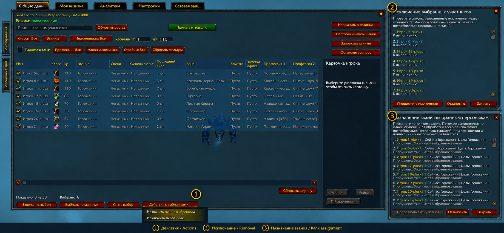
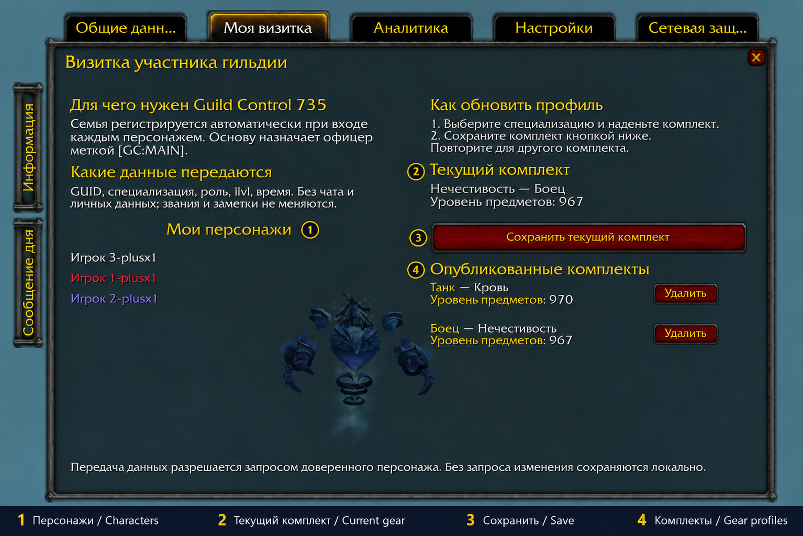
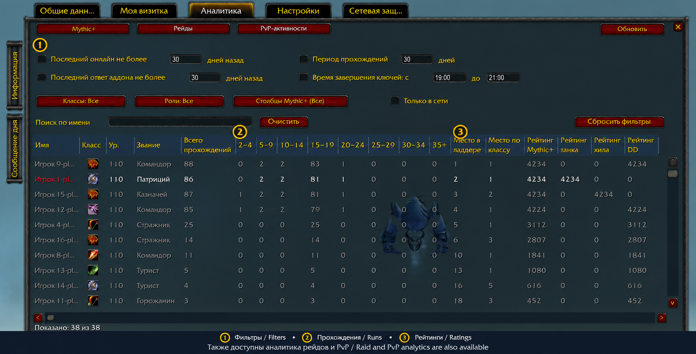
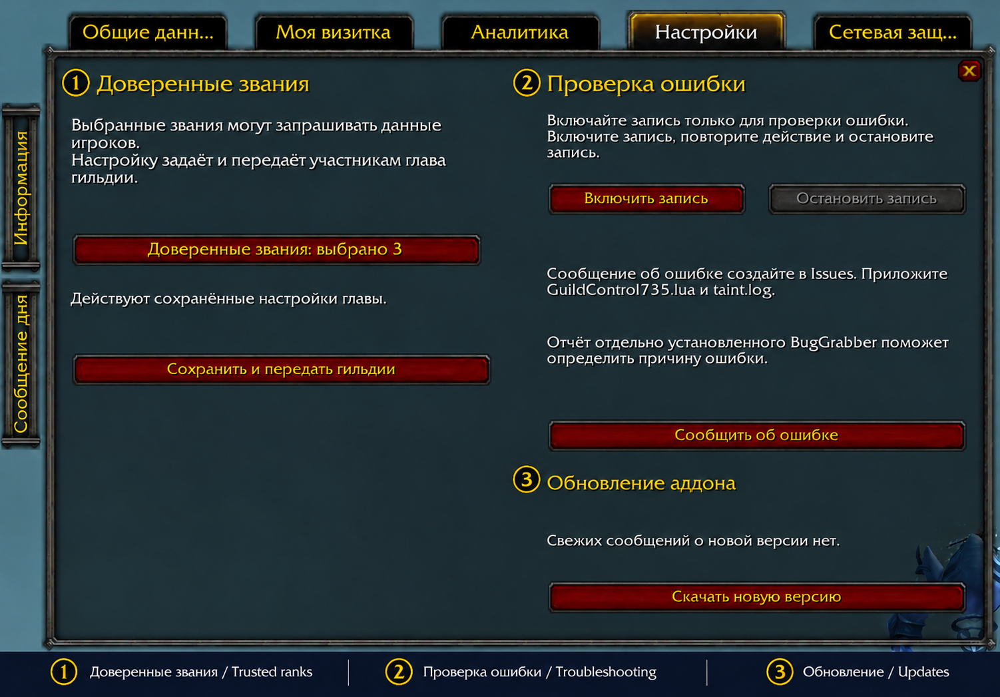
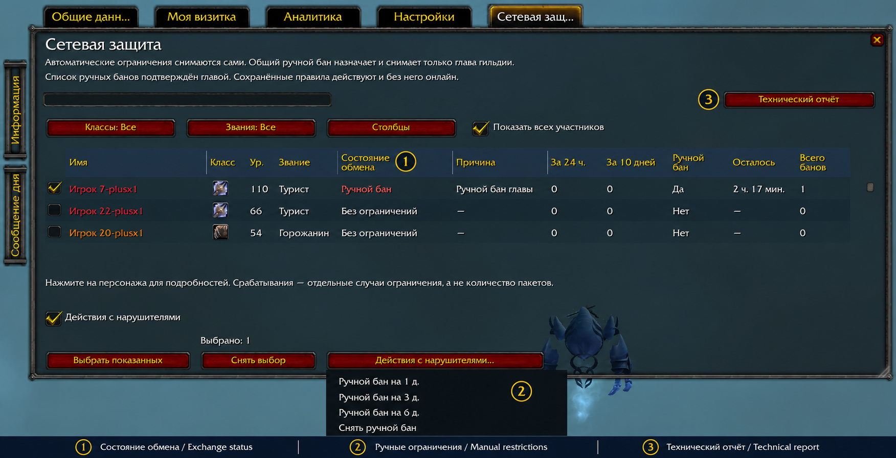

[Русский](USER_GUIDE.ru.md) · [README](../README.md) · [Download](https://github.com/JustAlex888/GuildControl735/releases)

# User guide
## Guild Control 735 for UWoW Legion

## Before installation

**Guild Control is designed for the guild master and as many guild members as possible to use it together.**

For shared use, the addon must be installed by the guild master and the players whose information you want to see. Installing it only for the guild master is not enough: equipment profiles, specializations, raid information and main/alt relationships come from members using Guild Control.

Mythic+ and PvP information available through the server ladder can be viewed without every member having the addon installed.

## Installation and first launch

### Installation

1. Download the installation ZIP from [Releases](https://github.com/JustAlex888/GuildControl735/releases).
2. Exit WoW completely.
3. Extract the **`GuildControl735`** folder into your UWoW Legion client's **`Interface\AddOns`** directory.
4. At character selection, open the addon list and make sure Guild Control is enabled.

The file should be located here:

```text
Interface\AddOns\GuildControl735\GuildControl735.toc
```

There should be no extra folder named after the downloaded archive between `AddOns` and `GuildControl735`.

### Opening the addon



Click the **Guild Control minimap button** or the **floating addon button** on your screen.

You can drag and resize the floating button. Place it wherever opening the window is most convenient during play.

You can also use **`/gc735`**.

### Initial guild setup

The guild master should open **Settings**, select trusted ranks and press **Save and share with guild**.

Trusted ranks determine who, in addition to the guild master, may request Guild Control data. Choose the ranks according to whom you want to assign this responsibility.

To share updated equipment profiles, the guild master or a member of a trusted rank must be online. After changing your equipment, save your equipped set again in My card.

### Updating the addon

1. Exit the game completely.
2. Remove the old **`GuildControl735`** folder from `Interface\AddOns`.
3. Replace it with the folder from the new installation archive.

**Keep your `WTF` folder:** it contains the addon's settings and saved data. A normal update does not require deleting it or resetting your settings.

### Interface language

Guild Control supports Russian and English. By default, it follows your WoW client's language.

To choose a language manually, use:

- **`/gc735 language ru`** — Russian;
- **`/gc735 language en`** — English;
- **`/gc735 language auto`** — follow the client language.

Run **`/reload`** after changing the language.

The selection changes Guild Control's interface. Character names, guild rank names, notes and other game data retain their original text.

## Using Guild data



### Set up your working window

Open Guild Control and select **Guild data**.

Resize the window to suit your screen. Open **Columns** and keep the information you need. To resize a column, drag the divider in its header.

Press **Reset widths** to restore the default column widths. Use vertical and horizontal scrolling to browse the table.

### Find members

Enter text in the search field or use filters:

- **Classes** — filter by character class.
- **Rank** — filter by guild rank.
- **Inactivity** — filter by time away from the game.
- **Level from / to** — set the level range.
- **Online only** — show members currently online.
- **Professions** — find characters with the professions you need.
- **Addon and specs** — filter by the availability of the corresponding data.

You can combine filters. For example, select a class, set the level range and enable **Online only**.

The number of matching characters appears below the table. Press **Reset filters** to clear the selection criteria.

### Open a player card



Click a member's row. Their card appears on the right.

Use **Mythic+**, **Raids** and the PvP activity button to view details. Available information depends on the data already received for that character.

### Refresh information

Press **Refresh roster** to refresh the standard guild roster information.

Press **Request data** to collect Guild Control information. This is available to the guild master and members of trusted ranks. Press **Stop request** to cancel the current request.

### Automatic data refresh — 0.0.103

An available guild master or trusted member automatically surveys online characters every 30 minutes. Successfully surveyed characters with a current matching mark are skipped for 8 hours. Surveys retrieve saved equipment profiles; after changing gear, save the current profile again.

One client leads the survey. A joining guild master or senior trusted member does not interrupt an active pass. Trusted clients exchange results and pending work; if the collector leaves, an available trusted client continues. All participating guild-master/trusted collectors need 0.0.103 for cooperative queue handover.

Each pass is limited to 15 minutes. At the limit, the queue is cleared and rebuilt 30 minutes later from eligible online characters. Received data and successful marks are retained. Missing information may cause repeat requests.

Request data manually bypasses the eight-hour interval. Stop request stops local collection and defers local automatic collection for 30 minutes. Ordinary members receive saved information on login and additionally every 2 hours when a data provider is available.

### Remind members to update their cards

Use the profile reminder button to ask members in guild chat to update their character information.

Open **Reminder settings** to configure the reminder. Before sending it, make sure the message is suitable for your guild.

### Invite a new member

If your character has permission to invite players:

1. Press **Invite to guild**.
2. Enter the character's name.
3. Confirm the invitation in the dialog.

### Work with an individual member

**Right-click a member in the table** to open the context menu. Depending on your guild permissions, you can change their rank, edit a note or remove the character from the guild.

To edit a note quickly, you can also **click the note's field directly in the table**. The editor for that note opens.

### Bulk rank changes and roster cleanup



Press **Manage guild roster** to work with several characters at once.

1. Find members using search and filters.
2. Select the characters you want to act on.
3. Choose a bulk rank change or guild removal.
4. Review the selected characters and confirm the operation.

This lets you change ranks for a group or clean up the roster without repeating the same action for each player. Available operations depend on your guild permissions.

### Read guild information

Click the **Information** or **Message of the day** side tab. Click the same tab again to close its panel.

You can select and copy the text in the panel.

## Using My card



### Save your first equipment profile

Open **My card**.

1. Activate the specialization you play.
2. Equip the matching gear.
3. Check the specialization, role and item level under **Current equipment**.
4. Press **Save equipped set**.

The saved profile appears under **Published equipment profiles**.

To share the information with your guild, the guild master or a member of a trusted rank must be online.

### Add a profile for another specialization

If you play several specializations, save a profile for each:

1. Switch to the other specialization.
2. Equip its matching gear.
3. Press **Save equipped set**.

Guildmates can then see your specializations and the equipment level for each one.

### Update or delete a profile

After changing your equipment, activate the relevant specialization, equip the updated gear and press **Save equipped set**. The previously saved information for that specialization is updated.

**Saved equipment profiles do not update automatically when you change gear.**

If you no longer need a profile, press **Delete** beside it in the published profiles list.

### Add your characters

**My characters** lists characters registered by the addon when you log in.

To add another character:

1. Enable Guild Control for that character.
2. Log into the game on that character.
3. Repeat for your other characters in the same guild.

When using one WoW account on one computer, the list is built automatically. You do not need to type names into My characters.

### Identify your main character

The guild master or a member with permission to edit **officer notes** marks the main character.

1. Find the main character in the guild roster.
2. Open their officer note for editing.
3. Add the exact **`[GC:MAIN]`** marker, keeping any note text you need.
4. Save the change.

Example officer note:

```text
[GC:MAIN]
```

Place the marker on the **main character**. Do not repeat it on that player's alts.

If several linked characters are marked as mains, the addon displays a warning. Check their officer notes and leave the marker on only one character.

### What the card shares

The card shares saved specializations and equipment levels, raid achievement information and character relationships.

Mythic+ and PvP activity are viewed in separate analytics sections and are not transmitted through the card.

## Using Analytics



Open **Analytics** and choose **Mythic+**, **Raids** or **PvP activities**.

### Viewing Mythic+

Mythic+ lets you compare member results: completed runs, runs by keystone level bracket, ladder positions and available ratings.

1. Open **Mythic+**.
2. Find members using search and filters.
3. Choose the metrics you need in the columns menu.
4. Click a column header to sort. Click again to reverse the order.

Use this to find members experienced with the key levels you are interested in and compare their results.

### Viewing raid progress

1. Open **Raids**.
2. Select a raid.
3. Select the difficulty.
4. Narrow the member list with search and class filters if needed.
5. Use **Raid columns** to keep the metrics you want.

The table shows accumulated boss-kill information for the selected raid and difficulty.

**These are character completion statistics, not a guild raid attendance log.** They do not identify the group a boss was defeated with or count weekly raid visits.

Press **Refresh** to request available raid data. Requests depend on trusted-rank permissions and members being online. Previously saved information remains if no fresh reply is received.

### Viewing PvP activity

1. Open **PvP activities**.
2. Choose **Week**, **Season** or **Previous season**.
3. Select **1×1**, **2×2**, **RBG**, **SoloQ 2×2** or **Overall statistics**.
4. Find members using search and filters.
5. Use **PvP columns** to select the metrics you need.

**Overall statistics** combines games, wins and losses. Ratings and MMR from different modes are not added together.

**Week means the server's weekly period, not the last seven days.** After the weekly reset, press **Refresh** to retrieve current information.

### Filtering by last online and addon reply

Analytics includes these limits:

- **Last online within** — keeps characters who have been online within the specified number of days.
- **Last addon reply within** — filters members by the age of a confirmed reply from their Guild Control.

Enable the corresponding checkbox and enter the number of days to apply a limit.

These fields filter members. They do not set the period for keystone runs, boss kills or PvP activity.

### Table layout and reading metrics

Use the columns menu, sorting and scrolling to focus on the results you need. Drag header dividers to resize columns that support resizing.

Hover over a row or metric to read its tooltip. **A dash is not zero:** it may mean confirmed information has not yet been received.

## Configuring trusted ranks



**The guild master selects trusted ranks.** They determine who, in addition to the guild master, may request Guild Control data.

### Assign trusted ranks

1. Open **Settings**.
2. Press **Trusted ranks**.
3. Select the ranks whose members should be allowed to request data.
4. Press **Save and share with guild**.

The guild master always has request access and cannot be deselected.

The selection applies to an entire rank. Consider which ranks members hold when granting access to a particular group of people.

### Change trusted ranks

Open the same list, add or remove selections, then press **Save and share with guild** again.

Trusted ranks allow exchange to continue without the guild master being online at all times. They **do not grant permission to apply or remove manual bans** on addon exchange.

## Using Network protection



### Why network protection exists

Guild Control exchanges data between guild members. A faulty or modified addon, or another tool imitating its messages, may generate excessive requests.

Automatic protection temporarily limits processing of that exchange. It protects Guild Control within an addon's capabilities; it is not universal DDoS or network-attack protection for the game or server.

Automatic protection runs for every member. The tab lets members view restrictions and gives the guild master additional control over manual bans.

### What the guild master should look for

If the same character repeatedly receives automatic restrictions, open Network protection. Review the reasons and the number of incidents **over the last 24 hours and 10 days**.

One incident does not call for an immediate manual ban. If activity repeats, we recommend contacting the player and checking their addon version. If the problem continues, the guild master can temporarily restrict exchange with that character while investigating.

Automatic incidents reflect observations on your computer, not a combined count of all incidents seen by every guild member.

### Find a character

1. Open **Network protection**.
2. Find the member using search or class and rank filters.
3. Enable **Show all members** if the character is not listed.
4. Click their row to view restriction details.

The table shows exchange status, restriction reason, incident information, manual-ban status and remaining time.

Automatic restrictions expire on their own.

### Apply a manual ban

This is available **only to the guild master**.

1. Enable **Restricted-player actions**.
2. Select the characters.
3. Press **Restricted-player actions…**.
4. Choose a manual ban for the required duration.
5. Review the character list and confirm.

You can select several members and apply the action to the whole selection.

**Select shown** selects only rows currently visible in the table. Press **Clear selection** to deselect them.

### Remove a manual ban

1. Enable **Restricted-player actions**.
2. Select the characters.
3. Open **Restricted-player actions…**.
4. Choose **Remove manual ban** and confirm.

Saved manual restrictions remain active while the guild master is offline.

### Who a ban applies to

A restriction applies to an **individual character**. Main/alt relationships do not extend it to the player's other characters.

To restrict exchange with several characters belonging to one player, select each one and apply a manual ban to the selection.

**A manual ban limits Guild Control exchange only.** It does not remove a character from the guild or change their guild permissions.

## If an error occurs

**Settings** includes **Error recording**, which lets you enable diagnostic recording and collect additional information for the developer.

You can report a problem in your own words: what you were doing, what happened and what you expected. Attach a screenshot if it helps explain the issue. Saved data and logs are particularly useful for identifying the cause of a software error.

### Materials that help the developer

- **`GuildControl735.lua`** — the addon's saved data. The file is created through addon use and written to disk when you exit the game.
- **`!BugGrabber.lua`** — saved Lua errors. It is available only if the separate **BugGrabber** addon is installed and has recorded the relevant error.
- **`taint.log`** — the client's diagnostic log. It can contain relevant information only if recording was enabled **before the error occurred**.

A description explains the situation, Guild Control data adds context, and a BugGrabber report may identify where the software failed. Reproducing the problem with recording enabled and attaching all three files gives the developer the most complete set of materials to investigate.

### Record a recurring error

If you know which actions trigger the problem:

1. Exit WoW completely and restart the client.
2. Log into the affected character.
3. Open **Settings → Error recording** and press **Start recording**.
4. Repeat the actions that caused the problem.
5. After the error occurs, press **Stop recording** and check the recording status message.
6. Exit the game completely so saved data is written to disk.
7. Copy the available files to send to the developer.

**Diagnostic recording runs for up to 10 minutes, after which the addon ends it automatically.** If you reproduce the error sooner, stop recording manually.

Enable recording after logging back in, immediately before testing. If the error does not recur, say so in your report.

### File locations

Paths are relative to your WoW client folder.

**Guild Control data:**

```text
WTF\Account\<account>\SavedVariables\GuildControl735.lua
```

**BugGrabber report, if installed:**

```text
WTF\Account\<account>\SavedVariables\!BugGrabber.lua
```

**Diagnostic log, if created after recording:**

```text
Logs\taint.log
```

Attach copies. Do not delete the originals or your `WTF` folder.

### If you cannot reproduce the error

Send a description and whatever materials are available. BugGrabber may have saved the original error even without diagnostic recording enabled.

Starting recording afterward cannot recover an earlier event. You can still ask for help without `taint.log`.

### Submit a report

Press **Settings → Report a bug**, copy the link and open it in your browser. Create a GitHub issue, state the addon version, describe your actions and attach the materials.

Before posting, review files and screenshots: they may contain character names, guild information and notes you do not want to disclose.
